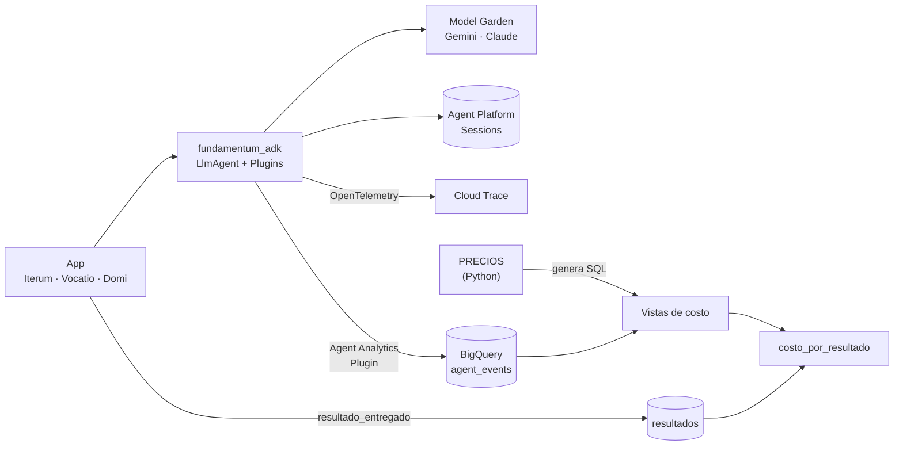

# Fundamentum

**Chasis de LLMOps para apps agent-native en Google Cloud. Mide cada llamada a un modelo y la
convierte en costo por resultado de negocio. Incluye conversaciones persistentes, guardrails, gates
de evals y control de acceso, en una sola dependencia versionada.**

[](https://github.com/Metuendus/fundamentum/actions/workflows/ci.yml)
[](docs/cambios.md)
[](pyproject.toml)
[](https://google.github.io/adk-docs/)
[](docs/medicion.md)
[](infra/)
[](https://docs.astral.sh/uv/)
[](https://docs.astral.sh/ruff/)

Como en la industria automotriz: un chasis estándar y, encima, varios modelos que no se parecen.
Fundamentum es la plataforma común de tres productos de IA: **Iterum** (viajes), **Vocatio**
(empleo) y **Domi** (vivienda). Aquí vive lo que las tres necesitan y que no las distingue:

- la capa de modelos y la forma de usar ADK;
- la medición de costo;
- la conversación en flujo y su historial;
- los eventos, los guardrails y las evaluaciones;
- el acceso durante la beta privada y el CI.

Cada app conserva sus agentes, su dominio y su marca.

---

## El problema

Las tres apps habían resuelto lo mismo, cada una a su manera:

- **IA.** Una app usaba ADK en Agent Runtime, otra llamaba a `google-genai` directamente y la
  tercera todavía no usaba modelos.
- **Costo.** Ninguna podía responder *cuánto cuesta entregar un resultado*: un viaje planeado, una
  postulación o una visita agendada.
- **Código duplicado.** `Evento`, `Propuesta` y el Despachador estaban copiados de un repo a otro y
  ya empezaban a divergir.
- **Operación.** Solo una app tenía CI automático, ninguna revisaba sus dependencias y cada una
  decidía por su cuenta quién podía entrar.

Fundamentum los reemplaza por **un solo camino**: toda llamada a un modelo pasa por ADK, se mide de
forma nativa y se convierte en costo por resultado en BigQuery.

## Qué resuelve

| | |
|---|---|
| 🧭 **Un solo camino a los modelos** | Gemini y Claude, ambos vía Model Garden y siempre por ADK. Cambiar el modelo de una tarea es configuración, no código. Cada intento a Gemini tiene un tope de 90 s, con reintento. |
| 💵 **Costo por resultado de negocio** | Los tokens de cada llamada, incluidos los subagentes, se cruzan en SQL con una tabla de precios versionada. Así se obtiene el costo por llamada, por día y **por resultado entregado**. |
| 💬 **Conversación en flujo y persistente** | Chat en flujo (SSE en Cloud Run) con sesiones en Agent Platform Sessions. La persona ve su historial al recargar o cambiar de dispositivo, y cada turno queda ligado a su traza en Cloud Trace. |
| ✂️ **Control de tokens** | Compactación del contexto largo, poda de lecturas repetidas de herramientas y un tope de llamadas al modelo por mensaje, como red para agentes en bucle. |
| 🔒 **Privacidad por configuración** | La analítica nunca guarda el texto de prompts y respuestas ni el estado de la sesión. Un filtro de logs redacta los datos personales. |
| 🛡️ **Guardrails como Plugins de ADK** | Alcance por identidad y recurso, topes de presupuesto antes de llamar al modelo y texto externo tratado como dato, nunca como instrucción. |
| 🚦 **Gate de evals en CI** | Corre `adk eval` y falla el build si una versión **duplica** los tokens, las llamadas al modelo o la latencia respecto a la línea base. |
| 📨 **Eventos con idempotencia y presupuesto** | Esquemas base, un Despachador para Pub/Sub con deduplicación y topes por usuario y globales, y un registro en Firestore con reclamación atómica. |
| 🎟️ **Acceso a la beta privada** | Una sola lista de quién entra a cada app, aplicada por un portero en Firebase Auth que falla cerrado, y **Atrium**, el panel privado (detrás de IAP) que la administra. |
| 🏗️ **Infraestructura y CI como código** | Un módulo de Terraform crea la medición en cada proyecto. Los workflows reutilizables de GitHub Actions dan a las tres apps el mismo CI, con auditoría de dependencias. |

## Arquitectura



1. La app construye sus agentes con las fábricas del chasis y registra los plugins una sola vez.
2. Las conversaciones se guardan en Agent Platform Sessions, y cada turno abre un span en Cloud
   Trace.
3. `BigQueryAgentAnalyticsPlugin` (nativo de ADK) escribe tokens, latencia, modelo y agente de cada
   llamada, sin contenido.
4. Las vistas calculan el costo en SQL. Si cambia un precio, el costo se recalcula hacia atrás.
5. La app emite `resultado_entregado` cuando cumple su promesa, y `costo_por_resultado` une las dos
   mitades.

## Problemas de producción que ya resolvió

Cada versión nace de un incidente real en alguna de las tres apps. El detalle completo está en
[`docs/cambios.md`](docs/cambios.md).

| Síntoma | Causa | Arreglo en el chasis |
|---|---|---|
| Una llamada a Gemini tardó **7.6 min** y el turno se perdió. | `google-genai` no reintenta el corte de aiohttp. | Tope de 90 s por intento, también en el servidor (`X-Server-Timeout`), y hasta 3 reintentos (1.1.0). |
| Una sesión pasó de **1,007 a 38,318 tokens de entrada** en cinco días, y un solo mensaje hizo **54 llamadas** al modelo. | El agente reenviaba el historial completo, con copias repetidas de la misma lectura. | `PluginPodar` deja solo la lectura más reciente y `PluginTopeLlamadas` corta los bucles (1.4.1). |
| El chat olvidaba la conversación al escalar a cero, o la persona no la veía al recargar. | Las sesiones vivían en memoria o no tenían historial visible. | Agent Platform Sessions e `Historial`, sin un almacén propio que mantener (1.4.0). |
| La analítica dejaba de registrar la respuesta final según el orden de los plugins. | Un plugin que devuelve el evento hace que ADK salte los `on_event_callback` siguientes. | `PluginResumen` modifica el evento en su lugar, así que el orden ya no importa (1.4.1). |
| El primer `terraform apply` de una app falló a la mitad. | BigQuery rechaza una vista sobre un comodín que todavía no tiene tablas. | Las vistas de resultados se activan aparte (1.0.0). |

## Paquetes

Monorepo con un workspace de [uv](https://docs.astral.sh/uv/). Cada paquete se versiona y se instala
por separado.

| Paquete | Qué trae | API principal |
|---|---|---|
| [`fundamentum-modelos`](python/fundamentum_modelos) | Registro tarea→modelo, precios de Model Garden con fuente y fecha, costo por llamada y generador del SQL de precios. Sin dependencias. | `Registro`, `PRECIOS`, `Uso`, `costo_usd` |
| [`fundamentum-adk`](python/fundamentum_adk) | Modelos ADK para Gemini y Claude, llamadas de una vuelta con salida por esquema, conversación en flujo, sesiones e historial, trazas, contexto largo, analítica, guardrails y redacción de datos personales. | `modelo_adk`, `agente_unico`, `llamar_sync`, `Conversacion`, `Historial`, `sesiones_agent_platform`, `activar_trazas`, `analitica`, `PluginAlcance`, `PluginPresupuesto`, `PluginPodar`, `PluginTopeLlamadas` |
| [`fundamentum-eventos`](python/fundamentum_eventos) | Esquemas base que cada app extiende, Despachador para Pub/Sub, reintentos y registro en Firestore. | `EventoBase`, `PropuestaBase`, `Despachador`, `con_reintentos` |
| [`fundamentum-evals`](python/fundamentum_evals) | Runner sobre `adk eval` y gate de eficiencia contra una línea base del repo de la app. | `evaluar`, `comparar`, `python -m fundamentum_evals` |
| [`fundamentum-acceso`](python/fundamentum_acceso) | Lista de acceso común, decisión determinista por app y portero para las funciones bloqueantes de Firebase Auth. | `decidir`, `crear_portero`, `LectorFirestore`, `Permiso` |
| [`apps/atrium`](apps/atrium) | Panel privado en Next.js y TypeScript, detrás de IAP: modo de cada app, solicitudes, lista de acceso, cuentas y bitácora. | Cloud Run |
| [`infra/modulos/medicion`](infra/modulos/medicion) | Terraform: dataset `agentes`, permisos, sink de resultados y 5 vistas de costo. | `module "medicion"` |
| [`.github/workflows`](.github/workflows) | Workflows reutilizables: `python-uv`, `web-node`, `reglas-firebase` y `terraform`. | `uses: …@v1.5.0` |

## Así se ve en una app

Una extracción estructurada con Gemini, medida y con costo:

```python
from fundamentum_adk import agente_unico, analitica, llamar_sync, modelo_adk

PLUGINS = analitica("vocatio")  # BigQuery Agent Analytics con la configuración privada

agente = agente_unico(
    "memoria",
    modelo_adk("gemini-3.8-flash", proyecto="vocatio-mx", credenciales=cred),
    esquema=ExtraccionCv,  # Pydantic
    instruccion=INSTRUCCION,
    temperatura=0.1,
)
r = llamar_sync(agente, [parte_pdf, "Extrae el CV."], plugins=PLUGINS, usuario=uid, app="vocatio")
r.texto, r.uso, r.costo_usd()  # el costo alimenta el Evento y el presupuesto del Despachador
```

Un chat en flujo con herramientas, sesiones persistentes y traza ligada a la petición web:

```python
from fundamentum_adk import Conversacion, PluginResumen, contexto_entrante, sesiones_agent_platform

sesiones = sesiones_agent_platform(proyecto, os.environ["DOMI_SESIONES_MOTOR"])
chat = Conversacion(
    agente, plugins=[*plugins, PluginResumen(agente.name)], app="domi", sesiones=sesiones
)

async for e in chat.conversar(
    texto,
    usuario=uid,
    sesion_id=sid,
    estado={"uid": uid},  # la identidad la fija el servidor en cada turno
    traza_entrante=contexto_entrante(request.headers),
):
    ...  # Trozo, LlamadaHerramienta, RespuestaHerramienta y, al final, Fin con uso y costo
```

Los guardrails se registran una vez en el `App`:

```python
from fundamentum_adk import PluginAlcance, PluginPresupuesto, analitica, instalar_filtro

instalar_filtro()  # nada de datos personales en los logs
app = App(
    name="iterum",
    root_agent=root_agent,
    plugins=[
        PluginAlcance(
            requeridas=("uid", "trip_id"), vinculos={"trip_id": "trip_id"}, verificar=es_miembro
        ),
        PluginPresupuesto(agotado=registro_agotado, clave_recurso="trip_id"),
        *analitica("iterum"),
    ],
)
```

La guía completa, con eventos, evals, acceso y Terraform, está en
[`docs/adopcion.md`](docs/adopcion.md).

## Decisiones de ingeniería

Las razones completas están en [`docs/decisiones.md`](docs/decisiones.md), en formato ADR, y en
[`docs/ci.md`](docs/ci.md).

- **Medición nativa en lugar de un plugin propio.** La primera versión tenía su propio
  `PluginMedicion`. Se reemplazó por el `BigQueryAgentAnalyticsPlugin` oficial y Cloud Trace. El
  chasis solo aporta los precios y las vistas, y así se mantiene menos código.
- **Productos administrados antes que almacenes propios.** Las sesiones viven en Agent Platform
  Sessions (USD 0.25 por cada 1,000 eventos, centavos al mes con el uso actual) y no en una colección
  de Firestore hecha a mano.
- **El costo vive en SQL, no en el proceso.** Los precios se definen en Python
  (`fundamentum_modelos.PRECIOS`) y de ahí se genera `precios.sql`. Una prueba falla si los dos se
  desfasan.
- **Ningún modelo sin precio.** Un modelo que no está en la tabla falla en voz alta en Python. En
  BigQuery la vista lo marca como `precio_desconocido` y deja el costo en nulo: nunca lo reporta
  como 0.
- **Tarifa estándar, no promocional.** Subestimar el costo por resultado es peor que sobrestimarlo
  cuando ese número sostiene un precio de venta.
- **El SQL también se prueba.** Las vistas se parsean como GoogleSQL con `sqlglot`, y
  `costo_llamadas` se ejecuta en DuckDB con eventos de ejemplo. Así no hace falta una cuenta de
  nube en CI.
- **Multiproveedor con evidencia.** Pasar una tarea de Gemini a Claude solo cambia el registro,
  pero la decisión la toma el gate de evals de esa tarea. Claude entra primero en tareas sin
  herramientas, porque ADK solo garantiza `output_schema` junto con herramientas en Gemini 3.
- **Guardrails como Plugins, no callbacks.** Es la recomendación de ADK: se registran una vez en el
  `App` y no en cada agente.
- **La identidad la pone el servidor.** `Conversacion` reescribe la identidad en el estado antes de
  cada turno, y la sesión de otra persona es `SesionAjena`: con el id de otro usuario no se ve su
  historial.
- **El acceso falla cerrado.** Si el portero no puede leer la lista, nadie entra. Atrium además
  verifica la firma de IAP y exige que el correo sea de un administrador.
- **Un gate de CI que tolera el ruido.** Falla si una métrica pasa del doble de la línea base *y*
  además la diferencia supera un mínimo, para que unos milisegundos de latencia no tumben el build.
- **CI con cadena de suministro cuidada.** Las acciones están fijadas por SHA, los permisos son
  mínimos, Dependabot corre cada semana y `pip-audit` y `npm audit` revisan cada lock. Las
  vulnerabilidades aceptadas llevan su razón escrita. `ci-ok` es el único check obligatorio.
- **La medición nunca rompe una conversación.** Un error al medir se registra y la llamada sigue.

## Estructura

```
fundamentum/
├─ python/
│  ├─ fundamentum_modelos/   registro, precios, costo y generador de SQL
│  ├─ fundamentum_adk/       modelos, llamadas, conversación, sesiones, trazas, guardrails
│  ├─ fundamentum_eventos/   esquemas, Despachador, reintentos y Firestore
│  ├─ fundamentum_evals/     runner de adk eval y gate de eficiencia
│  └─ fundamentum_acceso/    lista de acceso y portero de Firebase Auth
├─ apps/atrium/              panel privado de acceso (Next.js, Cloud Run + IAP)
├─ infra/
│  ├─ modulos/medicion/      Terraform y vistas SQL, con pruebas en DuckDB
│  └─ proyecto/              proyecto de GCP del chasis
├─ .github/workflows/        CI del chasis y workflows reutilizables para las apps
├─ plantillas/               CI, evals, portero y motor de sesiones para las apps
└─ docs/                     plan, adopción, medición, CI, UX de agentes, decisiones y cambios
```

## Instalación

El repo es público, así que cada app lo instala desde git, fijado por etiqueta. No hace falta
registro privado ni credenciales.

```toml
[project]
dependencies = ["fundamentum-adk[agentplatform]==1.5.0", "fundamentum-modelos==1.5.0", "fundamentum-eventos[firestore]==1.5.0"]

[tool.uv.sources]
fundamentum-adk = { git = "https://github.com/Metuendus/fundamentum", tag = "v1.5.0", subdirectory = "python/fundamentum_adk" }
fundamentum-modelos = { git = "https://github.com/Metuendus/fundamentum", tag = "v1.5.0", subdirectory = "python/fundamentum_modelos" }
fundamentum-eventos = { git = "https://github.com/Metuendus/fundamentum", tag = "v1.5.0", subdirectory = "python/fundamentum_eventos" }
```

Con pip:

```bash
pip install "fundamentum-adk @ git+https://github.com/Metuendus/fundamentum@v1.5.0#subdirectory=python/fundamentum_adk"
```

Con los workflows reutilizables, el CI de una app queda en unas líneas
([plantilla](plantillas/github/ci.yml)):

```yaml
jobs:
  python:
    uses: Metuendus/fundamentum/.github/workflows/python-uv.yml@v1.5.0
```

Al etiquetar una versión, `cloudbuild-publicar.yaml` también publica los paquetes en Artifact
Registry.

## Desarrollo

Requiere Python 3.11 o 3.12 y [uv](https://docs.astral.sh/uv/). Atrium requiere Node.

```bash
uv sync --all-packages
uv run ruff check . && uv run ruff format --check . && uv run pytest -q
terraform fmt -check -recursive infra   # el validate de cada módulo corre en CI (.github/workflows/ci.yml)
```

Las pruebas corren sin credenciales de nube: los modelos se simulan y el SQL se ejecuta en DuckDB.
Después de cambiar `PRECIOS`, regenera el SQL con `uv run python -m fundamentum_modelos.sql`. Fuera
de Cloud Run, Atrium corre en modo de demostración con datos en memoria (ver su
[README](apps/atrium/README.md)).

## Estado y hoja de ruta

**v1.5.0.** Backend completo, conversación persistente, acceso común y CI compartido. Iterum,
Vocatio y Domi lo adoptan antes de cualquier funcionalidad nueva.

- [x] **Medir:** registro de modelos, precios, analítica nativa y vistas de costo (1.0).
- [x] **Eventos:** esquemas base, Despachador y registro en Firestore (1.0).
- [x] **Guardrails y evals:** plugins de alcance y presupuesto, privacidad y gate de costo y
  latencia (1.0).
- [x] **Conversación:** chat en flujo, sesiones, historial visible, trazas y contexto largo
  (1.2–1.4).
- [x] **Acceso:** lista común, portero de Firebase Auth y Atrium (1.3).
- [x] **CI compartido:** GitHub Actions, workflows reutilizables y Dependabot (1.5).
- [ ] **Design system único:** `@fundamentum/tokens` y `@fundamentum/ui`, sobre una base MiniMax
  con un tema por app.
- [ ] **Uso en Atrium y tablero de negocio:** costo por resultado, aceptación y retención.

El plan original está en [`docs/plan.md`](docs/plan.md) y el historial de versiones en
[`docs/cambios.md`](docs/cambios.md). La lista de UX que siguen los agentes de las tres apps está en
[`docs/ux-agentes.md`](docs/ux-agentes.md).

## Reglas del chasis

- Entra solo lo que ya usan dos apps, o lo que es estándar obligatorio (medición, IA). Nada
  específico de un dominio.
- Es obligatorio en las tres apps: lo compartido nunca se reimplementa en una app.
- Las apps fijan la versión por etiqueta de git; nada de submódulos ni de `main`.
- Los esquemas base viven aquí y cada app los extiende en su `packages/schemas`.
- El chasis nunca bloquea un release candidate: si una app necesita algo urgente, lo hace en local
  y después lo sube.
- El repo es público: ningún secreto ni dato de usuarios en el código.

---

Hecho por [José Carlos Corona](https://github.com/Metuendus).
